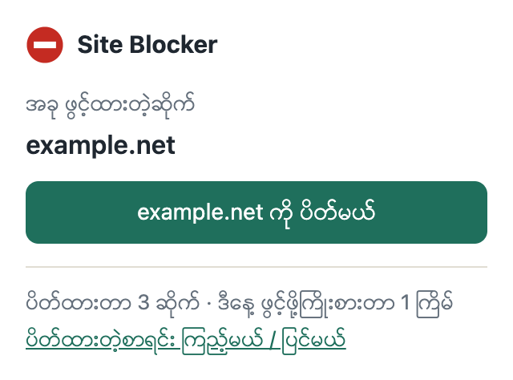
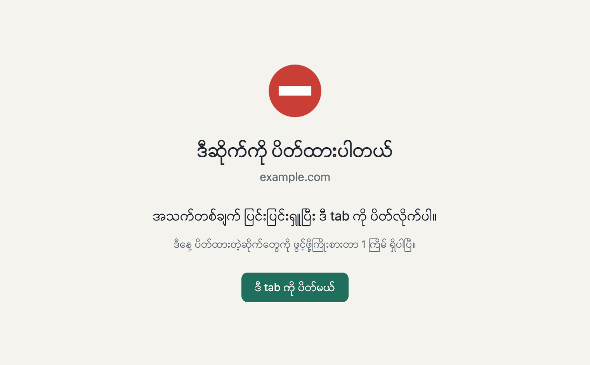
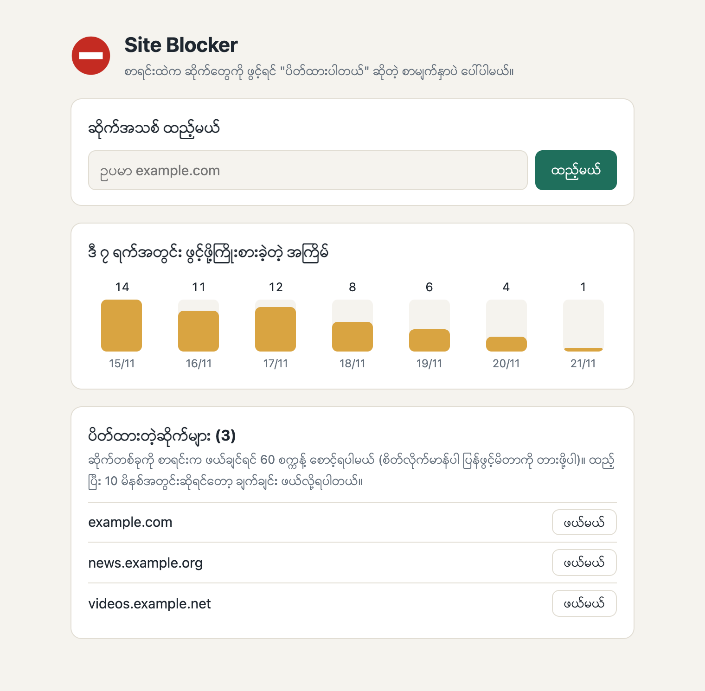

# Site Blocker

စွဲနေတဲ့ဆိုက်တွေကို ကိုယ်တိုင်ပိတ်ထားပြီး လုပ်စရာရှိတာကို အာရုံစိုက်နိုင်ဖို့ Chrome extension ပါ။ ဘယ်ဆိုက်ကို ပိတ်မလဲဆိုတာ ကိုယ်တိုင်ရွေးရပါတယ်။

A Chrome extension that blocks the sites you keep going back to, so you can focus. You choose the sites. The interface is in Burmese — [English below](#english).

  
  

## ဘာလုပ်ပေးလဲ

- **တစ်ချက်နှိပ်ရုံနဲ့ ပိတ်နိုင်ပါတယ်။** ပိတ်ချင်တဲ့ဆိုက်ကို ဖွင့်ထားရင်း toolbar က Site Blocker icon ကို နှိပ်ပြီး "ပိတ်မယ်" ကို နှိပ်ပါ။
- **ပိတ်ထားတဲ့ဆိုက်ကို ဖွင့်ရင်** "ဒီဆိုက်ကို ပိတ်ထားပါတယ်" ဆိုတဲ့ စာမျက်နှာပဲ ပေါ်ပါတယ်။ `example.com` ကို ပိတ်ရင် `www.example.com`၊ `m.example.com` လို subdomain တွေပါ ပိတ်ပါတယ်။
- **ပြန်ဖွင့်ဖို့ ခက်အောင် လုပ်ထားပါတယ်။** စာရင်းထဲက ဆိုက်တစ်ခုကို ဖယ်ချင်ရင် စက္ကန့် ၆၀ စောင့်ရပါတယ်။ စိတ်လိုက်မာန်ပါ ပြန်ဖွင့်မိတာကို တားဖို့ပါ။ မှားထည့်မိတာဆိုရင်တော့ ထည့်ပြီး ၁၀ မိနစ်အတွင်း ချက်ချင်း ဖယ်လို့ရပါတယ်။
- **ကိုယ့်အကျင့်ကို မြင်ရပါတယ်။** ပိတ်ထားတဲ့ဆိုက်တွေကို တစ်နေ့ ဘယ်နှစ်ခါ ဖွင့်ဖို့ကြိုးစားမိလဲ ရေတွက်ပြပါတယ်။
- **အချက်အလက်ကို ဘယ်ကိုမှ မပို့ပါ။** စာရင်းနဲ့ အရေအတွက်တွေက ကိုယ့် browser ထဲမှာပဲ ရှိပါတယ်။

## ထည့်နည်း

1. ဒီစာမျက်နှာအပေါ်က အစိမ်းရောင် **Code** ခလုတ်ကို နှိပ်၊ **Download ZIP** ကို နှိပ်ပြီး ရလာတဲ့ဖိုင်ကို ဖြည်ပါ။
2. Chrome address bar မှာ `chrome://extensions` လို့ရိုက်ပြီး Enter နှိပ်ပါ။
3. ညာဘက်အပေါ်ထောင့်က **Developer mode** ကို ဖွင့်ပါ။
4. **Load unpacked** ကို နှိပ်ပြီး ဖြည်ထားတဲ့ folder ကို ရွေးပါ။

toolbar မှာ icon ကို အမြဲမြင်ချင်ရင် puzzle ပုံလေးကို နှိပ်ပြီး Site Blocker ဘေးက pin ကို နှိပ်ထားပါ။

## သိထားဖို့

- ဖြည်ထားတဲ့ folder ကို မဖျက်ပါနဲ့၊ မရွှေ့ပါနဲ့။ Chrome က အဲဒီ folder ထဲကနေ တိုက်ရိုက်သုံးနေတာပါ။
- Developer mode ကို ဖွင့်ထားတဲ့အတိုင်း ထားပါ။ ပိတ်လိုက်ရင် extension ရပ်သွားနိုင်ပါတယ်။
- Incognito window မှာပါ ပိတ်ချင်ရင် `chrome://extensions` က Site Blocker ရဲ့ **Details** ထဲမှာ **Allow in Incognito** ကို ဖွင့်ပါ။
- ကွန်ပျူတာပေါ်က Chrome မှာပဲ အလုပ်လုပ်ပါတယ်။ တခြား browser နဲ့ ဖုန်းမှာ မပိတ်ပါ။
- ဒါက ကိုယ့်ကိုကိုယ် ထိန်းဖို့ အကူပါ၊ သော့မဟုတ်ပါ။ extension ကို ပိတ်လိုက်ရင် ဆိုက်တွေ ပြန်ပွင့်ပါတယ်။

## English

Site Blocker stops you from opening the sites you keep drifting back to. Nothing is blocked until you add it.

- **Block in one click.** Open the site, click the Site Blocker icon in the toolbar, then the block button. Subdomains are covered too.
- **A blocked site shows a plain "this site is blocked" page** instead of loading.
- **Unblocking takes patience.** Removing a site from the list needs a 60-second wait, so an impulse cannot undo the block. A site added by mistake can be removed at once during the first 10 minutes.
- **See the habit.** It counts how often you tried to open a blocked site each day.
- **Nothing leaves your browser.** No account, no analytics, no network requests.

The interface text is in Burmese only.

### Install

1. Click the green **Code** button on this page, choose **Download ZIP**, and unzip the file.
2. Open `chrome://extensions` in Chrome.
3. Turn on **Developer mode** (top right).
4. Click **Load unpacked** and choose the unzipped folder.

### Good to know

- Keep the folder where it is; Chrome runs the extension from it.
- Leave Developer mode on, or Chrome may switch the extension off.
- For Incognito windows, turn on **Allow in Incognito** under the extension's **Details**.
- Desktop Chrome only (tested on Chrome 157). Other browsers and phones are not covered.
- It is a self-control aid, not a lock: switching the extension off unblocks everything.

### Permissions

- **Access to all sites** and `declarativeNetRequest`: needed to send whichever sites you add to the block page.
- `storage`: keeps your list and the daily counts inside the browser.

### Development

There is no build step. `python3 tests/test_ext.py` runs an end-to-end check in a separate headless Chrome with a throwaway profile; add `--full` to sit through the 60-second wait as well. The path to Chrome is set at the top of `tests/cdp.py` (macOS by default). `python3 tools/make_icons.py icons` redraws the icons.

### License

[MIT](LICENSE)
